# Sound Garden

A free website that teaches reading, with a real home page and the whole course behind a **Start** button. Sounds first, then words, then short stories.
No account, no ads, no age question, no timer for children. Your garden grows as you read: a seed is planted when a lesson starts, it sprouts as you go and
blooms when the lesson is done. Plants never wilt. Sprig the seed friend is the guide.

Sound Garden is the web edition of [Sound Out](https://github.com/oyekamal/sound-out): the same seven-level course, the same teaching engine and the same voiced clips.

| Home page (1280) | Home page (390) |
|---|---|
| 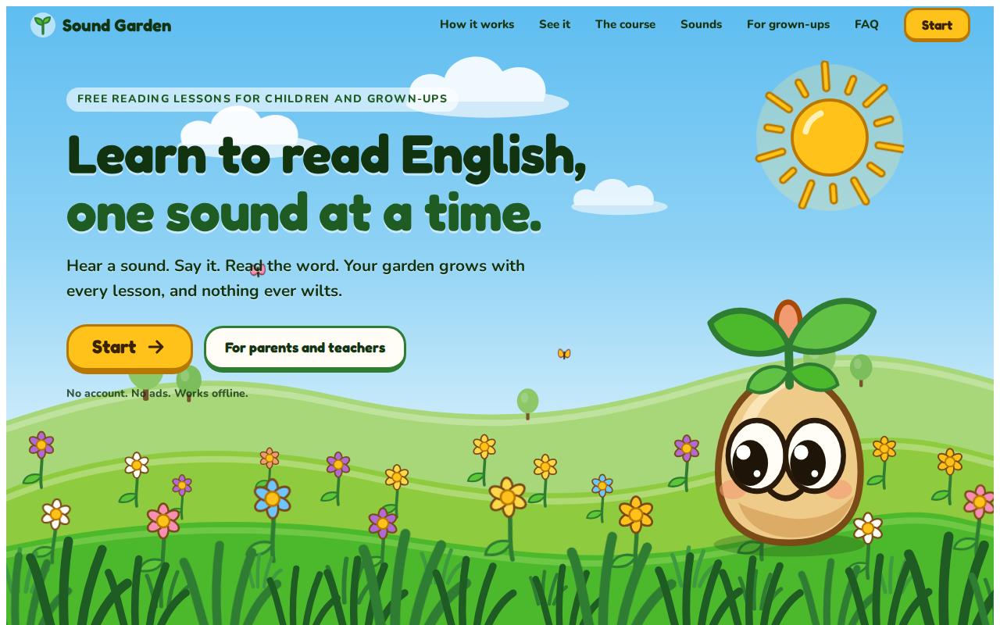 | 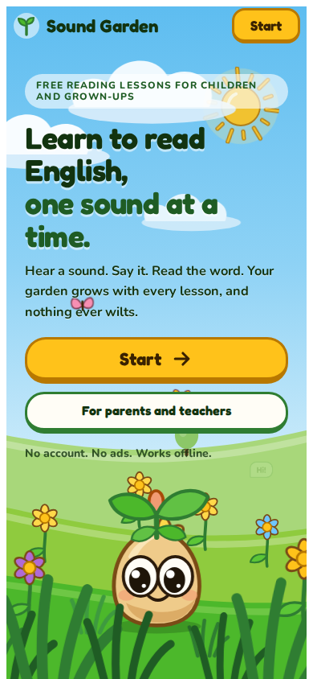 |

Real motion (frames of the live page, played back as taken, so a little choppier than the real thing):

| Hero | First run: the seed hatches | Lesson done | Garden Home |
|---|---|---|---|
| 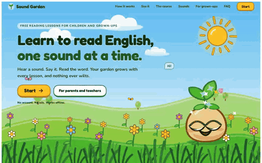 | 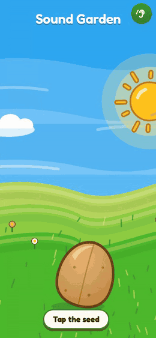 | 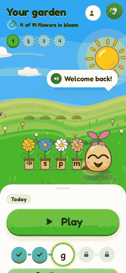 | 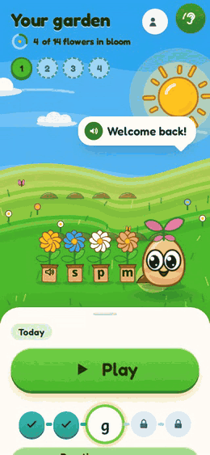 |

Frame strips (time runs left to right): [hero](shots/site/final/hero-strip.png) · [hatch](shots/site/final/hatch-strip.png) · [garden Home](shots/site/final/home-strip.png) · [celebration](shots/site/final/end-strip.png) · [a lesson](shots/site/final/lesson-strip.png) · [Sprig's poses](shots/site/final/sprig-poses.png) · [a hop](shots/site/final/sprig-hop.png) · [full page, phone](shots/site/final/page-390.png) · [full page, desktop](shots/site/final/page-1280.png).

## Screenshots

**Landing page, full length**

| Desktop (1280) | Phone (390) |
|---|---|
| 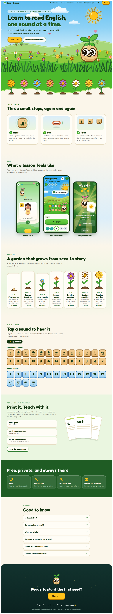 | 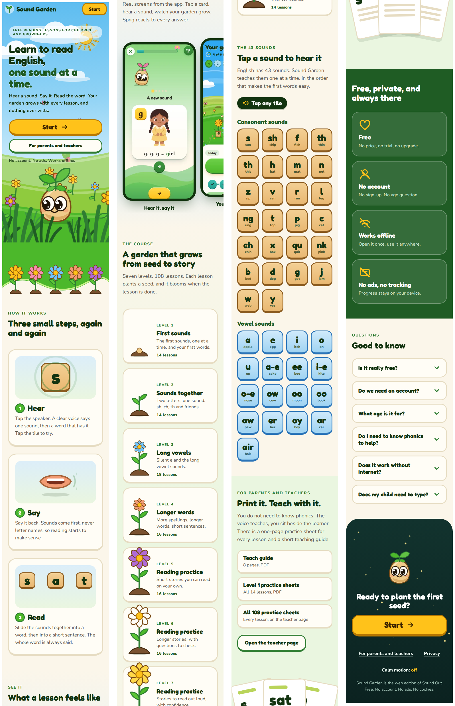 |

**Inside the app** (phone width)

| Who is reading | Garden home | A lesson | Hear a sound |
|---|---|---|---|
| 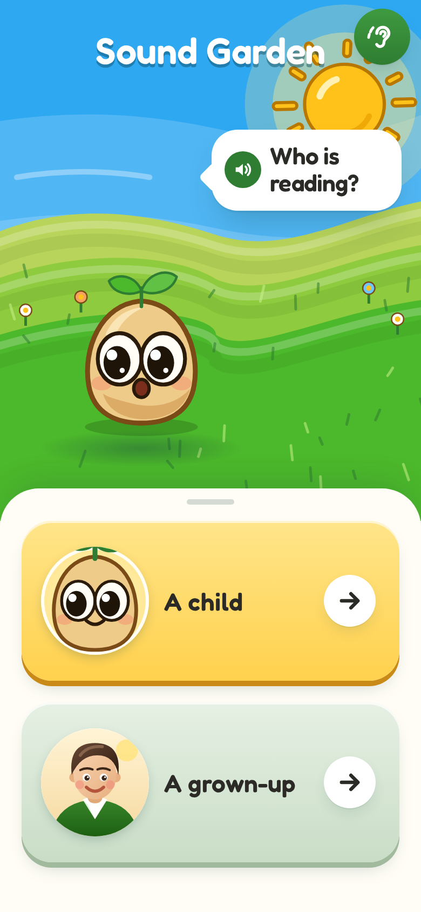 | 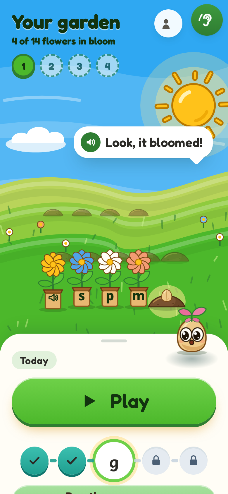 | 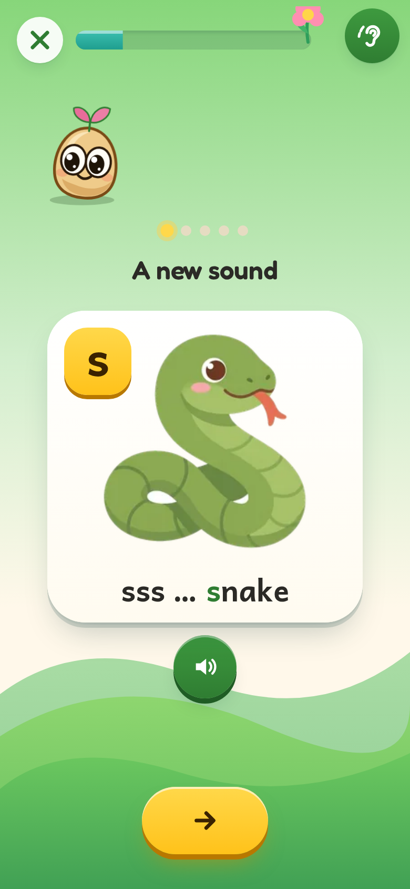 | 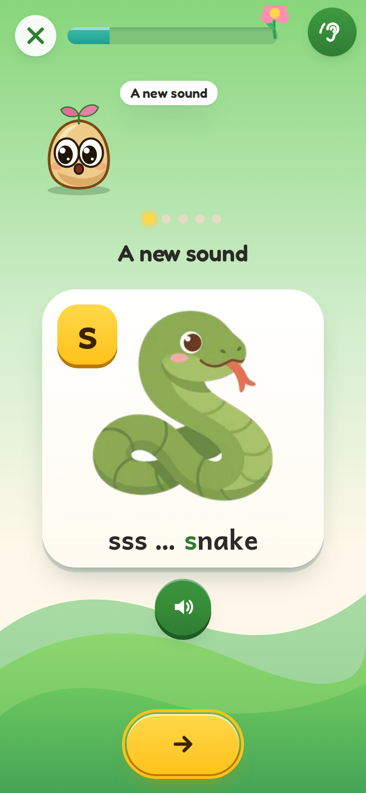 |

| Blending | Practice | Sound it out | Teacher page |
|---|---|---|---|
| 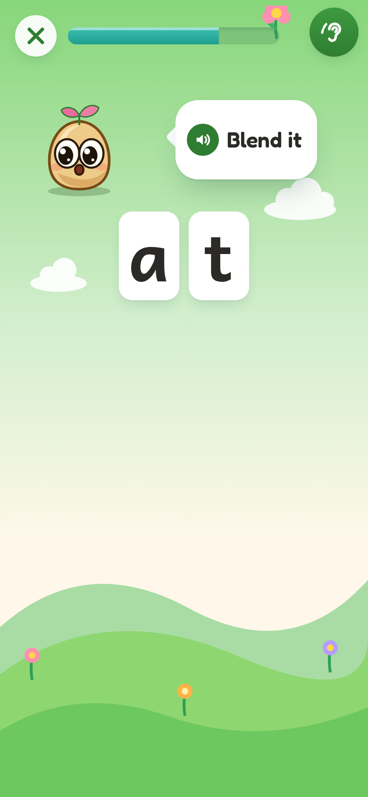 | 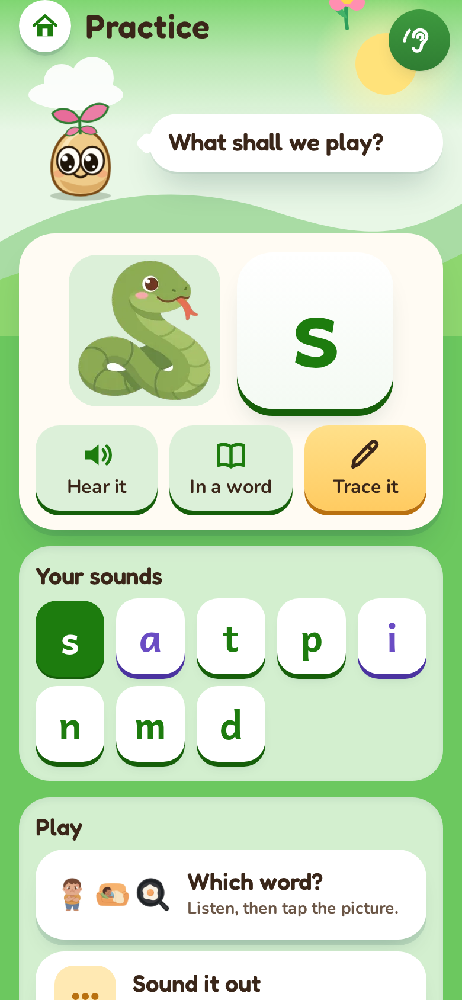 | 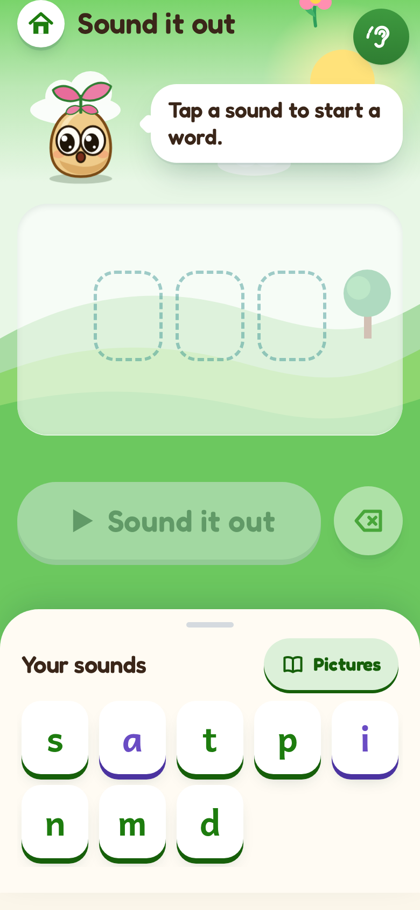 | 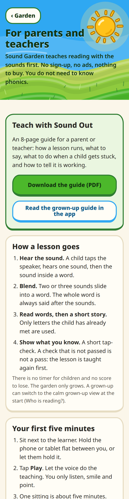 |

| Sprig's poses | Lesson frames | Seed hatching |
|---|---|---|
|  | 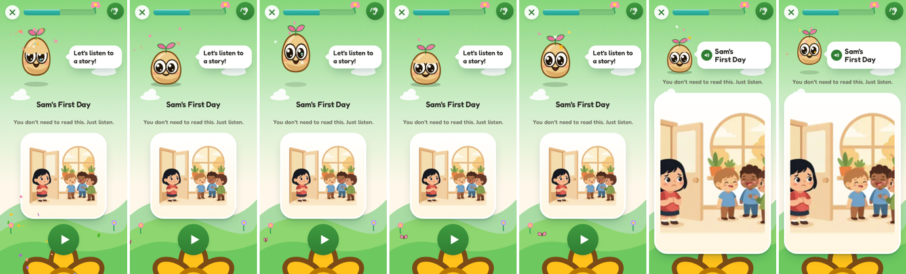 | 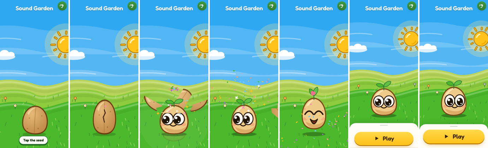 |

## The site

* `#/` the home page: a hero garden (sky, sun, clouds, three hills, swaying flowers, butterflies) that slides against itself as you scroll or move the pointer, with Sprig
  waving, blinking, breathing and following your finger. Then: how it works (hear, say, read), real screens from the app, the course as a garden of seven plants that grow in,
  the 43 sounds (tap a tile to hear it), printable practice pages and the teacher guide, the privacy promises, FAQ, and a dusk footer where Sprig sleeps.
* `#/play` the app. A first run starts with a seed on a hill: tap it, it cracks, shell pieces fly, Sprig pops out and waves. Lessons, practice, Sound it out and the garden Home all move on springs.
* `#/teach` for parents and teachers: the guide, a do and don't list, and a printable page for every lesson.
* One **Calm motion** switch (home page footer, the grown-ups area, and the phone's "reduce motion" setting all end in the same switch): nothing loops, nothing flies, everything shows its finished state.

## How the motion works

`src/motion/engine.js` is a tiny spring-physics core (one value, one target, a stiffness and a damping) with one `requestAnimationFrame` loop that sleeps when nothing moves.
Everything is built on it: `popIn` and `stagger` (cards rise and settle 85 ms apart), `countTo` (numbers spring to their value), `bump`, press-squash springs on every button,
canvas confetti, a toast. `src/sprig/sprig.js` is Sprig: breathing, random blinks, eye glances, a poke that squashes and sends hearts, moods (idle, happy, cheer, sleepy, thinking,
oops, listening, speaking, surprise), hops with a shadow that answers them, stars, hearts, petals, drops and zzz. `so-overlay/fx.js` and `so-overlay/hatch.js` carry it into the app.
Only transforms and opacity move; big art is static and the swaying parts are tiny separate elements, so the compositor does the work.

## What is in it

* Levels 1-7 (108 lessons), 43 isolated sounds with the 5-step meet-a-sound flow, 7,925 voiced clips (about 78 MB, one request per clip, cached as played).
* Teaching flow: sound, blend, words, sentences. A failed check is not a pass: the lesson is taught again first.
* Track A (a child, with Sprig) and Track B (a grown-up learner, calm, no mascot).
* Sound it out (build a word, split it into sounds, say it), a Practice area (hear and trace sounds, replay words), helper mode.
* `#/teach`: the Teach guide (8-page PDF) and a printable practice page for every lesson.
* Shareable links: `#/play`, `#/play/lesson/L2.04`, `#/play/practice`, `#/play/sound-it-out`, `#/teach`. The browser Back button goes back one step.
* Offline after the first visit (service worker); install from the browser menu.

## How it is built

`so/` is a copy of Sound Out's `app/src` and `content/`. `so-overlay/` replaces a few files (Sprig for Tilo, the garden Home, boot code, skin) and
`tools/sync_sound_out.py` applies the overlay and a short list of patches, so `python3 tools/sync_sound_out.py --pull` brings Sound Out fixes in.
`src/` is the Sound Garden shell: router, landing page, teacher page, Sprig rig, art. See `plan/PORT-PLAN.md`, `plan/PORT-VERDICT.md` (the port) and `plan/SITE-VERDICT.md` (the website and motion pass, with the critic results).

```
npm ci && npm run dev        # http://localhost:5390
npm run build                # dist/  (deployable as is)
npm run preview              # serve dist/ locally on :5390
npm test                     # unit tests (spring engine, Sprig states)
npm run gates                # content gates: decodable words, Finch rules, sound keys
node tools/size_budget.mjs   # landing page weight, static: limit 300 KB gzip (today about 97 KB)
python3 tools/landing_budget.py   # the same, measured with a real browser against a running site (dev or preview)
python3 tools/fps_check.py        # frame times under a 4x slower CPU (landing hero, scroll, garden Home, celebration)
python3 tools/check_urls.py && python3 tools/check_offline.py     # need Playwright; the first needs the site on :5390
python3 tools/site_shots.py OUT   # full-page and frame-strip captures of the home page
python3 tools/motion_strip.py OUT && python3 tools/hatch_strip.py OUT && python3 tools/lesson_strip.py OUT && python3 tools/make_gifs.py OUT
```

## Deploy

`npm run build` writes a static site to `dist/`. It uses relative URLs and hash routes (`#/play`, `#/teach`), so it works at any path and needs no server rewrites.
`dist/` is about 105 MB because it carries the 7,925 voice clips (78 MB) and the printable PDFs; the home page itself loads about 97 KB before any audio.

* **GitHub Pages**: push to `master`; `.github/workflows/pages.yml` builds and uploads `dist/`. In the repository settings choose Pages, source "GitHub Actions".
  (Without the workflow: `npm run build`, then publish the `dist/` folder with any Pages action or the `gh-pages` branch.)
* **Netlify**: connect the repository. `netlify.toml` sets the build command, `dist` as the publish folder and long cache headers for assets and audio. Or `npx netlify deploy --prod --dir=dist`.
* **Vercel**: import the repository. `vercel.json` sets the build, the output folder and the same headers. Or `npx vercel deploy --prod` from the repo root.
* **Any static host**: copy `dist/`. Serve `sw.js` and `index.html` with `no-cache` so a new deploy shows up on the next load (the service worker keeps the site working offline after the first visit).

