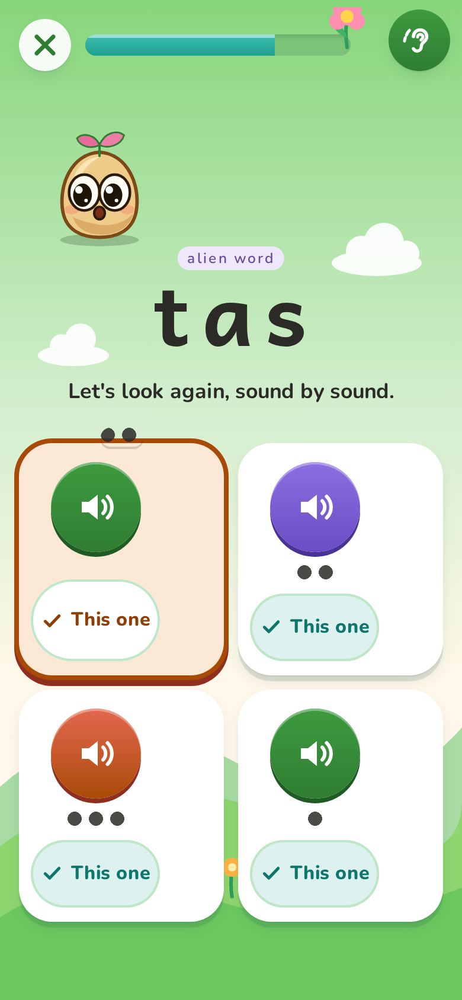
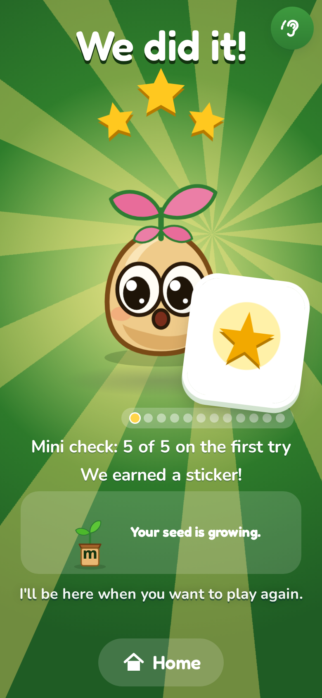
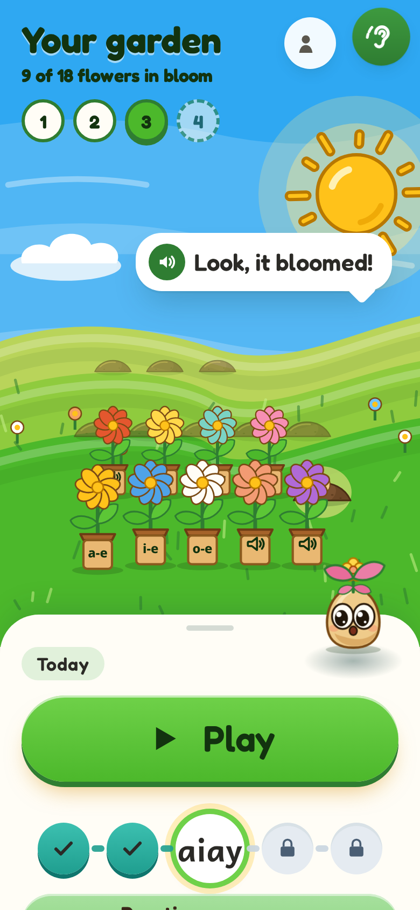
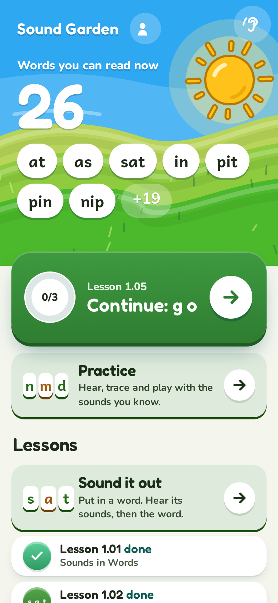

# Sound Garden

Learn to read English for free. Sounds first, then words, then short stories. No account, no ads, no age question, no timer for children.
Your garden grows as you read: a seed is planted when a lesson starts, it sprouts as you go, and it blooms when the lesson is done. Plants never wilt.

Sound Garden is the web edition of [Sound Out](https://github.com/oyekamal/sound-out): the same seven-level course, the same teaching engine and the same
voiced clips, with a garden for artwork and progress, and Sprig the seed friend as the guide.

| Who is reading? | Your garden | Hear a sound | Blend |
|---|---|---|---|
|  |  |  |  |

| Check, miss and repair | A seed that grew | Practice | Sound it out |
|---|---|---|---|
|  |  |  |  |

| Garden, level 3 | Grown-up view (Track B) | For parents and teachers |
|---|---|---|
|  |  |  |

## What is in it

* Levels 1-7 (108 lessons), 43 isolated sounds with the 5-step meet-a-sound flow, 7,925 voiced clips (about 78 MB, one request per clip, cached as played).
* Teaching flow: sound, blend, words, sentences. A failed check is not a pass: the lesson is taught again first.
* Track A (a child, with Sprig) and Track B (a grown-up learner, calm, no mascot).
* Sound it out (build a word, split it into sounds, say it), a Practice area (hear and trace sounds, replay words), helper mode.
* `#/teach`: the Teach guide (8-page PDF) and a printable practice page for every lesson.
* Shareable links: `#/play`, `#/play/lesson/L2.04`, `#/play/practice`, `#/play/sound-it-out`, `#/teach`. The browser Back button goes back one step.
* Offline after the first visit (service worker); install from the browser menu.

## How it is built

`so/` is a copy of Sound Out's `app/src` and `content/`. `so-overlay/` replaces a few files (Sprig for Tilo, the garden Home, boot code, skin) and
`tools/sync_sound_out.py` applies the overlay and a short list of patches, so `python3 tools/sync_sound_out.py --pull` brings Sound Out fixes in.
`src/` is the Sound Garden shell: router, landing page, teacher page, Sprig rig, art. See `plan/PORT-PLAN.md` and `plan/PORT-VERDICT.md`.

```
npm ci && npm run dev        # http://localhost:5390
npm run build                # dist/
python3 tools/check_decodable.py && python3 tools/check_finch.py       # content gates
python3 tools/so-compat/tools/check_ph_keys.py                        # sound key check
python3 tools/check_urls.py && python3 tools/check_offline.py         # need Playwright (dev server on :5390 for the first)
```
